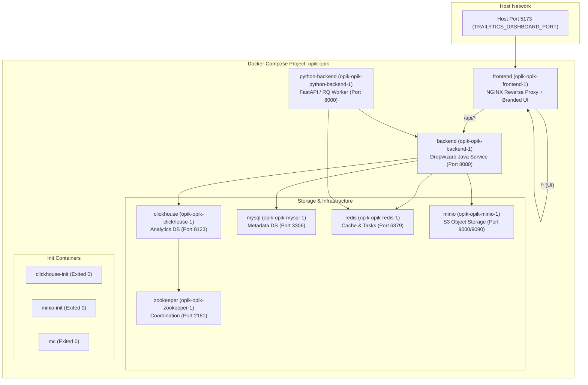

# Phase 3.1: Trailytics CLI & Deployment Architecture Audit

**Status:** Completed Audit  
**Date:** 2026-11-21  
**Target Version:** Trailytics 0.3.0 (built on Opik 2.2.138)  
**Execution Mode:** Audit Only (No source or deployment modifications)

---

## 1. Executive Summary

Trailytics has completed:
* **Phase 1:** Core branding, frontend customization, build fingerprinting, deployment identity enforcement, demo-data disabling, and startup diagnostic retries.
* **Phase 2:** Python SDK integration (`src/trailytics/`) providing `@trailytics.track`, `trailytics.configure`, `trailytics.flush`, and `trailytics.Client`, fully verified against the live deployment with 24 passing tests.

The goal of **Phase 3** is to provide a coherent developer tool and CLI (`trailytics start`, `trailytics stop`, `trailytics status`, etc.) that unifies the deployment lifecycle with the Python SDK experience.

### Key Audit Findings
1. **Deployment Source of Truth:** Deployment orchestration is currently split between Trailytics wrapper scripts ([trailytics/lib.sh](file:///home/ron/fcode/trailytics/trailytics/lib.sh), [trailytics/start.sh](file:///home/ron/fcode/trailytics/trailytics/start.sh)) and the upstream launcher ([upstream/opik/opik.sh](file:///home/ron/fcode/trailytics/upstream/opik/opik.sh)).
2. **Project Identity Invariance:** The Docker Compose project name is strictly derived as `opik-opik`. All active persistent database volumes are named `opik-opik_*`. Any change to this project identity would immediately orphan user data and spin up empty database volumes.
3. **High Reusability:** Phase 1 built robust pre-flight checks, fingerprinting, and diagnostic collection in [trailytics/lib.sh](file:///home/ron/fcode/trailytics/trailytics/lib.sh). The future Python CLI should wrap and execute these existing mechanisms rather than reimplementing Docker Compose orchestration from scratch in Python.
4. **CWD & Path Assumptions:** While `trailytics/lib.sh` resolves repository root via `BASH_SOURCE[0]`, upstream `opik.sh` contains unquoted string interpolations that break when repository paths contain spaces. Furthermore, a standalone `pip install` without repository access would lack the Docker Compose manifests and submodule scripts.

---

## 2. Current Repository and Deployment Architecture

### 2.1 Repository Layout
```text
/home/ron/fcode/trailytics/
├── config/
│   └── trailytics.env             # Trailytics distribution settings
├── frontend/
│   ├── assets/                    # Branded assets (trailytics-favicon.svg)
│   └── patches/                   # Git patches applied to upstream frontend
├── pyproject.toml                 # Package definition & pinned dependencies
├── src/
│   └── trailytics/                # Phase 2 Python SDK
│       ├── __init__.py
│       ├── client.py
│       ├── config.py
│       ├── context.py
│       ├── exceptions.py
│       └── tracker.py
├── trailytics/                    # Phase 1 deployment & build lifecycle scripts
│   ├── build-frontend.sh
│   ├── install.sh
│   ├── lib.sh
│   ├── start.sh
│   ├── status.sh
│   └── stop.sh
└── upstream/
    └── opik/                      # Pinned upstream Git submodule (2.2.138, commit 28192d8)
        ├── apps/
        ├── deployment/docker-compose/
        │   ├── docker-compose.yaml
        │   └── ...
        └── opik.sh
```

### 2.2 Ownership Model
* **Trailytics Outer Repository:** Owns product branding, frontend patches, build fingerprinting, wrapper scripts, SDK interface, documentation, and the upcoming CLI.
* **Upstream Opik Submodule:** Owns the underlying backend service, database migrations, Python backend, storage schemas, Fern-generated REST clients, and Docker Compose definition.
* **Deployment Engine:** Docker Compose v2 via [upstream/opik/deployment/docker-compose/docker-compose.yaml](file:///home/ron/fcode/trailytics/upstream/opik/deployment/docker-compose/docker-compose.yaml).

---

## 3. Lifecycle Script Inventory

### 3.1 Detailed Script Analysis

| Script | Location | Responsibility | Commands Executed | Invocation Method | Safety Checks & Handling |
| :--- | :--- | :--- | :--- | :--- | :--- |
| **`lib.sh`** | `trailytics/lib.sh` | Shared utilities, pre-flight checks, identity verification, build fingerprinting, startup diagnostics. | `docker info`, `docker compose version`, `git rev-parse`, `sha256sum`, `docker inspect`, `docker logs` | Sourced by all other Trailytics scripts. | Enforces Docker availability, pinned Git commit, clean submodule status, and project identity matching. Rejects foreign containers. |
| **`start.sh`** | `trailytics/start.sh` | Starts Trailytics stack with on-demand frontend build, startup verification loop, and automatic retries. | Executes `build-frontend.sh` if needed, then calls `run_upstream` (which executes `opik.sh`). | Invoked directly: `./trailytics/start.sh`. | Outer retry loop (default 3 attempts, 15s delay). Emits last 40 log lines of unhealthy containers before retrying. Never tears down on failure. |
| **`stop.sh`** | `trailytics/stop.sh` | Stops all containers safely without removing volumes. | Calls `run_upstream --stop` (which runs `docker compose -p opik-opik ... down`). | Invoked directly: `./trailytics/stop.sh`. | Asserts deployment identity first. Uses non-destructive `down` (no `-v` flag). Preserves all data. |
| **`status.sh`** | `trailytics/status.sh` | Reports health status of all containers in the stack. | Calls `run_upstream --verify` (which calls `check_containers_status` in `opik.sh`). | Invoked directly: `./trailytics/status.sh`. | Asserts deployment identity. Inspects `.State.Status` and `.State.Health.Status`. Returns 0 if all healthy, 1 otherwise. |
| **`build-frontend.sh`** | `trailytics/build-frontend.sh` | Rebuilds branded frontend image only when inputs change. | `docker build`, `docker tag`, `patch` | Invoked directly or via `start.sh`. | Hashes patches, assets, and commit. Tags built image as `trailytics-frontend:2.2.138` and aliases to `ghcr.io/comet-ml/opik/opik-frontend:2.2.138`. |
| **`install.sh`** | `trailytics/install.sh` | Clones/initializes submodule if missing, builds frontend, and executes `start.sh`. | `git submodule update --init`, calls `build-frontend.sh`, `exec start.sh`. | Invoked for initial checkout setup. | Verifies upstream commit and initiates startup. |
| **`opik.sh`** | `upstream/opik/opik.sh` | Upstream deployment engine script. | `docker compose -p opik-opik ... up -d`, `down`, `ps`, `inspect` | Delegated to by `lib.sh` via `run_upstream`. | Polls individual container health checks (up to 90s per container). Supports flags: `--verify`, `--stop`, `--clean` (destructive). |

### 3.2 Sources of Truth
* **Starting deployment:** `trailytics/start.sh` calling `upstream/opik/opik.sh` (subcommand: default).
* **Stopping deployment:** `trailytics/stop.sh` calling `upstream/opik/opik.sh --stop`.
* **Checking health:** `trailytics/status.sh` calling `upstream/opik/opik.sh --verify`.
* **Diagnostics on failure:** `lib.sh::print_startup_diagnostics`.
* **Frontend build state:** `lib.sh::needs_frontend_build` & `trailytics/build-frontend.sh`.
* **Submodule & Identity verification:** `lib.sh::verify_upstream` & `lib.sh::verify_deployment_identity`.

---

## 4. Docker Compose Topology and Project Identity

### 4.1 Compose Project Identity: `opik-opik`
The Docker Compose project name is calculated by [upstream/opik/scripts/worktree-utils.sh](file:///home/ron/fcode/trailytics/upstream/opik/scripts/worktree-utils.sh#L13-L30):
```bash
get_worktree_id() {
    local worktree_path
    worktree_path=$(git -C "$WORKTREE_PROJECT_ROOT" rev-parse --show-toplevel 2>/dev/null)
    ...
    name=$(basename "$worktree_path" | ...)
    echo "$name"
}
```
Because `upstream/opik` is a submodule, `git rev-parse --show-toplevel` inside `upstream/opik` returns `/home/ron/fcode/trailytics/upstream/opik`. The directory basename is `opik`. Therefore:
$$\text{RESOURCE\_PREFIX} = \text{"opik-"} + \text{"opik"} = \text{"opik-opik"}$$
$$\text{COMPOSE\_PROJECT\_NAME} = \text{"opik-opik"}$$

> [!CRITICAL]
> **Data Loss Risk:**
> Docker Compose names all anonymous and named volumes with the project prefix: `${COMPOSE_PROJECT_NAME}_${VOLUME_NAME}`.
> Existing database volumes on this machine are named:
> * `opik-opik_mysql`
> * `opik-opik_clickhouse`
> * `opik-opik_clickhouse-server`
> * `opik-opik_clickhouse-config`
> * `opik-opik_minio-data`
> * `opik-opik_redis-data`
> * `opik-opik_zookeeper`
> 
> If the project name were changed (for instance, to `trailytics`), Docker Compose would attach containers to new, empty volumes (`trailytics_mysql`, `trailytics_clickhouse`, etc.). **All historical traces, spans, and projects would immediately become inaccessible.** Therefore, preserving `COMPOSE_PROJECT_NAME=opik-opik` is mandatory.

### 4.2 Service Topology



### 4.3 Container Health Check Matrix

| Container Name | Health Check Command | Interval | Timeout | Retries | Start Period |
| :--- | :--- | :--- | :--- | :--- | :--- |
| `opik-opik-mysql-1` | `mysqladmin ping -h 127.0.0.1 --silent` | 1s | 1s | 300 | - |
| `opik-opik-redis-1` | `nc -z localhost 6379` | 2s | 4s | 20 | 30s |
| `opik-opik-clickhouse-1` | `wget --spider -q http://127.0.0.1:8123/ping` | 1s | 1s | 300 | - |
| `opik-opik-zookeeper-1` | `echo ruok \| nc localhost 2181 \| grep -q imok` | 1s | 1s | 300 | - |
| `opik-opik-minio-1` | `MC_HOST_local=http://localhost:9000 mc ready local` | 1s | 10s | 30 | - |
| `opik-opik-backend-1` | `curl -f http://localhost:8080/health-check` | 1s | 600s | 600 | 1s |
| `opik-opik-python-backend-1` | `wget --spider --quiet http://127.0.0.1:8000/healthcheck` | 2s | 60s | 30 | 2s |
| `opik-opik-frontend-1` | `curl --fail --fail-early http://localhost:5173/health` | 1s | 30s | 10 | 1s |

---

## 5. Path and Installation Assumptions

### 5.1 Verified Behaviors
1. **Repository-Relative Resolution:**
   `trailytics/lib.sh` resolves root via `ROOT_DIR="$(cd "$(dirname "${BASH_SOURCE[0]}")/.." && pwd)"`.
   Invoking `./trailytics/start.sh` or `bash /absolute/path/to/trailytics/trailytics/start.sh` from any directory works reliably because `ROOT_DIR` is tied to `${BASH_SOURCE[0]}`.
2. **Submodule Anchoring:**
   `UPSTREAM_DIR="$ROOT_DIR/upstream/opik"` assumes that the Git submodule is checked out at `upstream/opik` relative to `ROOT_DIR`.
3. **Frontend Build Context:**
   `build-frontend.sh` writes to `$ROOT_DIR/.trailytics-build/frontend`. This directory is git-ignored and self-contained.

### 5.2 Identified Limitations & Failure Modes
1. **Paths Containing Spaces:**
   In [upstream/opik/opik.sh](file:///home/ron/fcode/trailytics/upstream/opik/opik.sh#L230):
   ```bash
   local cmd="docker compose -p ${COMPOSE_PROJECT_NAME} -f $script_dir/deployment/docker-compose/docker-compose.yaml"
   ...
   $cmd up -d ${BUILD_MODE:+--build}
   ```
   Because `$cmd` is evaluated unquoted, if the repository directory contains spaces (e.g. `/home/user/my projects/trailytics`), bash word splitting breaks `docker compose` with `no such file or directory`.
2. **Standalone `pip install` Limitation:**
   If a user installs the Python package via `pip install trailytics` into a separate Python environment outside the repository clone:
   * The Python package files live in `site-packages/trailytics`.
   * The `upstream/opik/` submodule, `config/trailytics.env`, and `frontend/patches/` do **not** exist in `site-packages`.
   * Any CLI attempting to start the local Docker deployment needs access to the repository root.

---

## 6. Configuration Inventory and Precedence

### 6.1 Configuration Variables

| Variable Name | Defined In | Default Value | Purpose | Consumer |
| :--- | :--- | :--- | :--- | :--- |
| `OPIK_VERSION` | `config/trailytics.env` | `2.2.138` | Pinned upstream Opik version | Docker build & Compose images |
| `OPIK_COMMIT` | `config/trailytics.env` | `28192d8ffe852...` | Pinned upstream Git commit | `lib.sh::verify_upstream` |
| `TRAILYTICS_FRONTEND_IMAGE`| `config/trailytics.env` | `trailytics-frontend:2.2.138` | Local tagged frontend image | `build-frontend.sh` |
| `TRAILYTICS_DASHBOARD_PORT` | `config/trailytics.env` | `5173` | Host port for NGINX frontend | Maps to `NGINX_PORT` in Compose |
| `TRAILYTICS_COMPOSE_PROJECT`| `config/trailytics.env` | `opik-opik` | Stable Docker Compose project | `lib.sh::verify_deployment_identity` |
| `CREATE_DEMO_DATA` | `config/trailytics.env` | `false` | Disables demo data container | Forwarded to `opik.sh` |
| `OPIK_FRONTEND_PULL_POLICY`| `config/trailytics.env` | `never` | Prevents overwriting local image | Compose pull policy |
| `TRAILYTICS_USAGE_REPORT_ENABLED`| `config/trailytics.env` | `false` | Disables anonymous telemetry | Forwarded to `OPIK_USAGE_REPORT_ENABLED` |
| `TRAILYTICS_STARTUP_TIMEOUT_SECONDS` | `config/trailytics.env` | `600` | Max wait time for container startup | Forwarded to `OPIK_MAX_STARTUP_RETRIES` |
| `TRAILYTICS_STARTUP_ATTEMPTS` | `config/trailytics.env` | `3` | Number of startup retry attempts | `start.sh` retry loop |
| `TRAILYTICS_STARTUP_RETRY_DELAY_SECONDS` | `config/trailytics.env` | `15` | Sleep delay between retry attempts | `start.sh` retry loop |
| `TRAILYTICS_URL` | SDK Environment | `http://localhost:5173/api/`| Default Python SDK backend URL | `src/trailytics/config.py` |
| `TRAILYTICS_PROJECT` | SDK Environment | `Default Project` | Default project for traces | `src/trailytics/config.py` |
| `TRAILYTICS_WORKSPACE` | SDK Environment | `default` | Default workspace for traces | `src/trailytics/config.py` |

### 6.2 Precedence Order
1. **Runtime Process Environment:** Environment variables explicitly set in the user shell (e.g., `TRAILYTICS_DASHBOARD_PORT=5180 trailytics start`).
2. **Configuration File (`config/trailytics.env`):** Loaded via `load_config` in `lib.sh`.
3. **Script Defaults:** Built-in fallbacks in `lib.sh` and `src/trailytics/config.py`.
4. **Upstream Defaults:** Defaults defined in `upstream/opik/opik.sh` and `docker-compose.yaml`.

---

## 7. Health Checks, Retries, and Diagnostics

### 7.1 Startup Verification Lifecycle
1. `trailytics/start.sh` calls `run_upstream` (which executes `upstream/opik/opik.sh`).
2. `opik.sh` launches containers via `docker compose up -d` (with profile `opik`).
3. `opik.sh` loops through the 8 required containers sequentially:
   * Inspects `docker inspect -f '{{.State.Status}}' "$container"` and `docker inspect -f '{{.State.Health.Status}}' "$container"`.
   * Waits with 1s sleep up to `max_retries` (`TRAILYTICS_STARTUP_TIMEOUT_SECONDS`, default 600s).
   * Once healthy, records startup duration.
4. If all containers become healthy, `opik.sh` returns exit code `0`.
5. If any container fails or times out:
   * `opik.sh` returns non-zero.
   * `start.sh` catches the failure and immediately calls `print_startup_diagnostics`.

### 7.2 Diagnostics Functionality (`print_startup_diagnostics`)
Defined in [trailytics/lib.sh](file:///home/ron/fcode/trailytics/trailytics/lib.sh#L65-L80):
* Lists all containers under `com.docker.compose.project=opik-opik` with status and exit codes.
* For every container where status is not `healthy` or exit code $\ne 0$:
  * Prints a diagnostic header.
  * Tails the last 40 lines of container logs (`docker logs --tail 40 "$name"`).
* Retries up to `TRAILYTICS_STARTUP_ATTEMPTS` (3) before terminating with exit code 1.
* **Safety:** Containers and volumes are left intact so the operator can inspect them or fix transient resource constraints.

---

## 8. Python CLI Integration Assessment

### 8.1 Package Structure & Entry Point
The package `trailytics` is configured in `pyproject.toml` with `src/` layout.
To register the CLI, `pyproject.toml` needs an entry point:
```toml
[project.scripts]
trailytics = "trailytics.cli.main:cli"
```
When installed via `pip install -e .`, the `trailytics` command is placed in `.venv/bin/trailytics`.

### 8.2 Execution Architecture Options

| Approach | Description | Pros | Cons | Recommendation |
| :--- | :--- | :--- | :--- | :--- |
| **Option A: Pure Python Docker SDK** | Reimplement all Docker Compose calls using `docker-py` or direct Docker Compose API in Python. | No bash dependencies. | Duplicates ~600 lines of complex compose flag logic, worktree offsets, and health check polling. High drift risk. | **Not Recommended** |
| **Option B: Subprocess Wrapper of Existing Scripts** | Python CLI locates repository root and executes `./trailytics/start.sh`, `stop.sh`, `status.sh`, etc., formatting output. | Reuses 100% of verified Phase 1 logic (fingerprinting, identity checks, retries, diagnostics). Zero drift risk. | Requires repository files to exist on disk. | **Recommended** |
| **Option C: Hybrid Python Controller** | Python CLI manages commands, parses flags, checks environment, and delegates execution to `trailytics/lib.sh` via a subprocess runner. | Structured CLI (help, version, rich tables) while delegating lifecycle mechanics to battle-tested bash scripts. | Requires clean repository path discovery. | **Recommended Evolution** |

### 8.3 Repository Path Discovery
The CLI must locate the repository root reliably:
1. Check `TRAILYTICS_REPO_DIR` environment variable (if explicitly set).
2. Check if current working directory contains `trailytics/lib.sh` and `config/trailytics.env`.
3. Check parent directories of the CLI module file (`Path(__file__).resolve().parents[...]`).
4. Fail with a clear, helpful error message if the repository root cannot be found:
   ```text
   Error: Trailytics repository root could not be located.
   Please run this command from within the Trailytics repository,
   or set TRAILYTICS_REPO_DIR to your repository path.
   ```

---

## 9. Proposed CLI Command Behavior

### 9.1 Command Specifications

#### 1. `trailytics start`
* **Classification:** Essential.
* **Action:** Reuses `trailytics/start.sh`.
* **Flags:**
  * `--build` / `--force-build`: Force frontend rebuild.
  * `--port <int>`: Override dashboard port (defaults to `5173`).
  * `--timeout <int>`: Override startup timeout in seconds.
* **Output:** Pre-flight status, build status, container startup progress table, and final dashboard URL (`http://localhost:5173`).
* **Error Handling:** Invokes `print_startup_diagnostics` if containers fail to start; returns exit code 1 without deleting volumes.

#### 2. `trailytics stop`
* **Classification:** Essential.
* **Action:** Reuses `trailytics/stop.sh`.
* **Output:** Clean confirmation that containers have stopped.
* **Safety:** Strictly non-destructive (`docker compose down` without `-v`).

#### 3. `trailytics status`
* **Classification:** Essential.
* **Action:** Combines `trailytics/status.sh` with live endpoint checks.
* **Output:**
  * Docker Compose project name (`opik-opik`).
  * Table of containers, states, health statuses, and port mappings.
  * HTTP endpoint reachability check (`/health` and `/api/is-alive/ping`).
  * Active Python SDK configuration summary.

#### 4. `trailytics logs`
* **Classification:** Essential.
* **Action:** Runs `docker compose -p opik-opik -f upstream/opik/deployment/docker-compose/docker-compose.yaml logs`.
* **Flags:**
  * `--service <name>`: Filter logs by specific service (e.g. `backend`, `frontend`, `clickhouse`).
  * `--tail <int>`: Number of lines to show (default: 100).
  * `-f` / `--follow`: Stream logs in real-time.

#### 5. `trailytics restart`
* **Classification:** Useful / Secondary.
* **Action:** Executes `stop` followed by `start`.
* **Error Handling:** If `stop` fails, halts before attempting `start`.

#### 6. `trailytics doctor`
* **Classification:** Essential.
* **Action:** Comprehensive diagnostic utility checking:
  1. Docker daemon status and permissions.
  2. Docker Compose v2 availability.
  3. Git submodule checkout & pinned commit verification (`28192d8`).
  4. Repository cleanliness (no unstaged edits in submodule).
  5. Port availability (checks if host port 5173 is already occupied).
  6. Existing volume integrity (`opik-opik_*`).
  7. Frontend image presence and fingerprint match.
  8. Deployment identity validation.

#### 7. `trailytics version`
* **Classification:** Essential.
* **Action:** Displays:
  * Trailytics Python package version (e.g. `0.2.0`).
  * Pinned Opik engine version (`2.2.138`).
  * Pinned Opik commit (`28192d8ffe85299f5c44032f705a9e518e6d1189`).
  * Docker image tags and build fingerprints.

---

## 10. Risks and Data-Preservation Considerations

### 10.1 Safety Matrix

| Risk | Consequence | Mitigation Mechanism |
| :--- | :--- | :--- |
| **Volume Deletion (`down -v`)** | Permanent loss of all traces, spans, and metadata in ClickHouse and MySQL. | **Strictly prohibited.** CLI commands must never invoke `down -v` or upstream `--clean`. |
| **Project Identity Drift** | Running with a project name other than `opik-opik` attaches to new, empty volumes. | CLI must enforce `COMPOSE_PROJECT_NAME=opik-opik` before any Docker operation. |
| **Contaminating Other Deployments** | Accidentally stopping containers belonging to an unrelated Opik checkout. | Retain `verify_deployment_identity` check from `lib.sh` which checks container `working_dir` labels. |
| **Submodule Modification** | Modifying upstream tracked files breaks reproducibility and git updates. | Enforce `verify_upstream` check ensuring submodule is clean and pinned to commit `28192d8`. |
| **Port Collisions** | Port 5173 taken by another local service causes frontend container failure. | `trailytics doctor` and `trailytics start` check port availability before startup. |

---

## 11. Recommended Phase 3 Implementation Plan

### Stage 1: CLI Framework & Discovery (Phase 3.2)
1. Add `[project.scripts]` to `pyproject.toml` pointing to `trailytics.cli.main:cli`.
2. Create `src/trailytics/cli/` module using `click` (already an Opik core dependency).
3. Implement `trailytics.cli.utils` for repository root discovery, environment loading, and subprocess execution.
4. Implement `trailytics version`.

### Stage 2: Core Lifecycle Commands (Phase 3.3)
1. Implement `trailytics start` delegating to `trailytics/start.sh`.
2. Implement `trailytics stop` delegating to `trailytics/stop.sh`.
3. Implement `trailytics restart`.
4. Implement `trailytics status` integrating `trailytics/status.sh` with backend HTTP health probes.

### Stage 3: Operational Diagnostics & Logs (Phase 3.4)
1. Implement `trailytics logs` wrapping Docker Compose log streaming.
2. Implement `trailytics doctor` performing comprehensive pre-flight verification.

### Stage 4: Testing & End-to-End Verification (Phase 3.5)
1. Unit tests for CLI parsing, arguments, error handling, and repo discovery.
2. Integration test executing `trailytics start`, `trailytics status`, `trailytics stop`, and validating that SDK traces still succeed.

---

## 12. Files to Modify in Phase 3

### New Files to Create:
* `src/trailytics/cli/__init__.py`
* `src/trailytics/cli/main.py`
* `src/trailytics/cli/commands/start.py`
* `src/trailytics/cli/commands/stop.py`
* `src/trailytics/cli/commands/status.py`
* `src/trailytics/cli/commands/logs.py`
* `src/trailytics/cli/commands/doctor.py`
* `src/trailytics/cli/commands/version.py`
* `src/trailytics/cli/runner.py` (subprocess execution wrapper for `trailytics/*.sh`)
* `tests/unit/test_cli.py`

### Existing Files to Modify:
* `pyproject.toml`: Add `[project.scripts]` entry point and dev dependencies if needed.
* `README.md`: Document CLI command usage (`trailytics start`, `status`, etc.).

### Files Strictly Untouched:
* Everything inside `upstream/opik/` (remains pinned at commit `28192d8ffe85299f5c44032f705a9e518e6d1189`).
* Existing Docker volumes and database storage.
* `config/trailytics.env` (kept stable for backward compatibility).
* `trailytics/*.sh` (reused as underlying execution engine).
